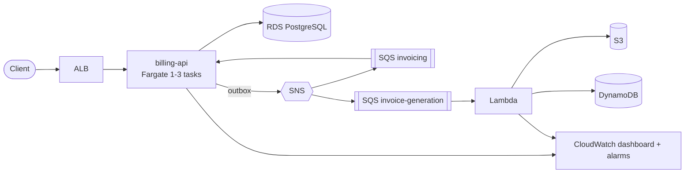

# Billing platform

Subscription and invoicing backend on AWS: Spring Boot service on ECS Fargate, event-driven
processing with SNS/SQS, invoice documents generated by Lambda (S3 + DynamoDB), infrastructure as code with AWS CDK
(Kotlin), deployed from GitHub Actions through OIDC.

## Architecture

Details, stack list and event flow: [docs/architecture.md](docs/architecture.md). Decisions: [docs/adr](docs/adr).

## Layout
- `services/billing-api` - Spring Boot service (subscriptions, invoices, payments)
- `services/invoice-lambda` - Lambda generating invoice documents
- `infra/` - AWS CDK app (Kotlin)
- `loadtest/` - k6 script
- `docs/` - architecture diagram and ADRs

## Status
- [x] CDK skeleton and `NetworkStack` (VPC, public/private subnets, S3 gateway endpoint)
- [x] billing-api on Fargate + RDS PostgreSQL
- [x] Events with SNS/SQS
- [x] CI/CD (GitHub Actions with OIDC) and invoice Lambda
- [x] Observability and load tests (dashboard, alarms, k6)
- [x] README, diagram, ADRs, cost note

Known gaps: Fargate scale-out was not observed in the 10-minute load test, and X-Ray tracing for the Fargate
service is not implemented (see [ADR 0005](docs/adr/0005-cost-over-high-availability.md)).

## Deploying
Prerequisites: AWS credentials, Node.js with the `aws-cdk` CLI, JDK 21, Docker (for the image).

```
cd infra
cdk bootstrap
cdk deploy NetworkStack DataStack MessagingStack InvoiceStack
cdk deploy ComputeStack -c desiredCount=0     # creates the ECR repository
# build the billing-api image and push it to the ECR repository "billing-api"
cdk deploy ComputeStack ObservabilityStack -c desiredCount=1 [-c alarmEmail=you@example.com]
```
Optional: `-c githubRepo=OWNER/REPO` (and `-c githubSubjectPrefix=...`) creates the OIDC role used by the
`deploy` workflow. Build the Lambda first: `cd services/invoice-lambda && bash gradlew buildZip`.

## Observability and load test
`ObservabilityStack` creates the `billing-platform` CloudWatch dashboard and alarms (ALB 5xx, p95 latency,
unhealthy hosts, Fargate/RDS CPU, RDS storage, both DLQs, Lambda errors/throttles) that notify the `billing-alarms`
SNS topic; the email subscription must be confirmed. The Fargate service scales 1-3 tasks on 60% CPU.

```
k6 run -e BASE_URL=http://<LoadBalancerDns> loadtest/subscriptions.js
```
Measured result (10 min ramp to 60 VUs): 18,190 iterations, 0% errors, p95 94 ms.

## Cost
The stacks are meant to be disposable. Approximate running cost in eu-central-1 while everything is up
(estimate from list prices, check the AWS pricing page):

| Item | ~USD / month |
|---|---|
| Fargate 0.5 vCPU / 1 GB, 1 task | 20 |
| Application Load Balancer | 18 |
| RDS `t4g.micro` + 20 GB | 15 |
| Public IPv4 addresses (ALB x2, task x1) | 11 |
| SQS, SNS, Lambda, DynamoDB, S3, CloudWatch at test volume | < 2 |
| **Total** | **about 65 (about 0.09 per hour)** |

A NAT Gateway is deliberately not used (it would add about 30 per month). A few hours of testing costs well under
1 USD.

## Tear down
Always destroy when done, in this order (reverse dependencies), then confirm in the console:

```
cd infra
cdk destroy ObservabilityStack ComputeStack InvoiceStack MessagingStack DataStack NetworkStack
```
ECR and the invoice bucket are configured with `DESTROY`/empty-on-delete, so no manual cleanup is needed.
Keep `GitHubOidcStack` (free) if you want to reuse the deploy workflow; remove it with `cdk destroy GitHubOidcStack`.
`cdk bootstrap` resources (the `CDKToolkit` stack) cost almost nothing and can stay.
