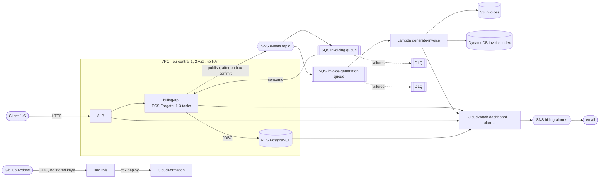

# Architecture

## Stacks

| Stack | Contents |
|---|---|
| `NetworkStack` | VPC, public + isolated subnets, S3 gateway endpoint, no NAT Gateway |
| `DataStack` | RDS PostgreSQL (`t4g.micro`, single AZ, 20 GB), credentials in Secrets Manager |
| `MessagingStack` | SNS topic, SQS queues, DLQs (14 days retention) |
| `ComputeStack` | ECR, ECS cluster, Fargate service (0.5 vCPU / 1 GB), ALB, CPU target-tracking 1-3 tasks |
| `InvoiceStack` | Lambda (Java 21, 512 MB), S3 bucket, DynamoDB (on-demand) |
| `ObservabilityStack` | dashboard, alarms, `billing-alarms` SNS topic |
| `GitHubOidcStack` | OIDC provider + deploy role for GitHub Actions (optional, kept between sessions) |

## Request and event flow

1. `POST /subscriptions` saves the subscription and an outbox row in one DB transaction.
2. A scheduled outbox job publishes the event to SNS (never inside the business transaction).
3. SNS fans out to two SQS queues: one consumed by billing-api, one by the invoice Lambda.
4. The Lambda writes the invoice to S3 and records it in DynamoDB; duplicates are idempotent
   (two identical messages produce one invoice).
5. Messages that keep failing land in a DLQ, which has an alarm.

Decisions: see [adr/](adr/).
